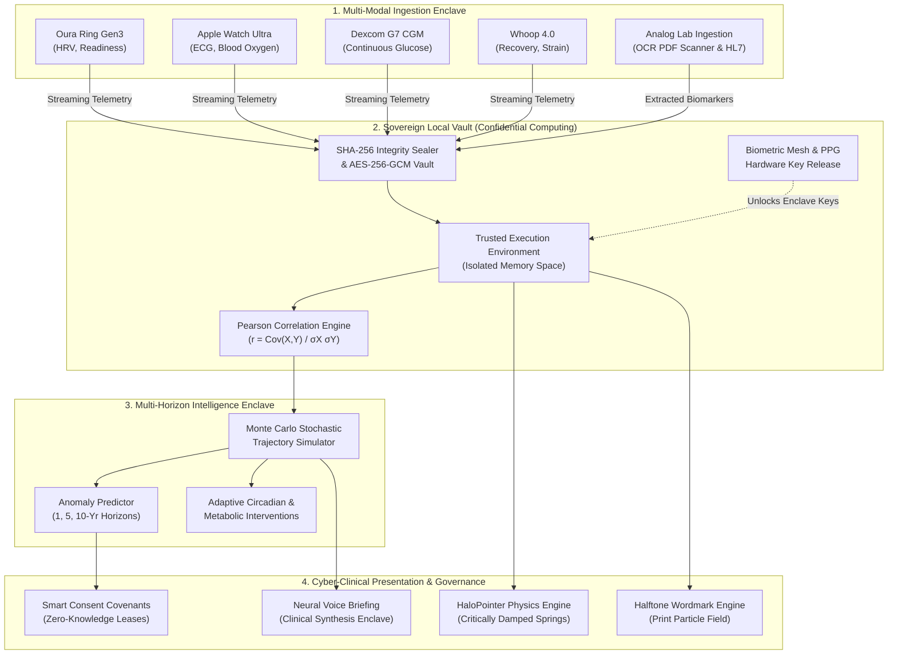

# 🛡️ AegisSelf — Self-Sovereign Biometric Intelligence & Zero-Knowledge Health Vault

<div align="center">


[](https://react.dev/)
[](https://www.typescriptlang.org/)
[](https://tailwindcss.com/)
[](https://vite.dev/)
[](https://motion.dev/)
[](https://ai.google.dev/)
[](LICENSE)

<br/>

**A confidential, client-side, zero-knowledge biometric intelligence enclave.**  
*Bridging continuous wearable telemetry, analog medical report OCR, multi-horizon health forecasting, and cryptographic data covenants into one sovereign health command center.*

[Explore Architecture](#-architecture) • [Key Features](#-core-capabilities) • [Live Demo & Video](#-interactive-walkthrough--demo) • [Quickstart](#-quickstart--local-development) • [Presentation Guide](#-judging--presentation-deep-dive)

</div>

---

## 📖 Executive Summary

Modern health data is fractured across proprietary silos, corporate fitness trackers, and legacy hospital portals. Users surrender complete privacy for fragmented insights, while clinical research and insurance providers lack cryptographically verifiable data provenance.

**AegisSelf** flips this paradigm through a **Local-First, Self-Sovereign Health Vault**:
- **Confidential Enclave Computing:** All telemetry, lab records, and predictive models execute entirely within your client enclave—sealed with deterministic **SHA-256 digests** and **AES-256-GCM** encryption.
- **Continuous Multi-Device Synthesis:** Ingests sub-second streaming metrics (HRV, RHR, glucose, deep sleep) from Oura, Apple Watch, Dexcom CGM, and Whoop with real-time Pearson correlation matrixing.
- **Analog Lab OCR Ingestion:** Transforms printed clinic PDFs and scanned lab sheets into structured biomarker records with integrity verification.
- **Multi-Horizon Risk Simulation:** Monte Carlo stochastic modeling projecting 1, 5, and 10-year metabolic, cardiovascular, and circadian anomaly trajectories.
- **Smart Data Covenants:** Programmable conditional consent agreements granting time-locked, zero-knowledge access to researchers without exposing raw medical identity.
- **Biometric Enclave Security:** Photoplethysmography (PPG) pulse analysis and facial contour mesh scanning for vault hardware key release.
- **Neural Voice Intelligence:** Executive clinical daily briefings synthesized via neural voice synthesis enclaves.
- **Cyber-Clinical Aesthetics:** Immersive ASCII cyber-vault hero, **HaloPointer** critically damped spring cursor physics, and **Halftone Wordmark** spring-repulsion particle footer.

---

## 🏛️ Architecture



---

## ⚡ Core Capabilities

### 1. 🛡️ Confidential Vault & Hardware Enclaves
- **Zero-Knowledge Architecture:** No personal medical telemetry is ever transmitted in plaintext to a centralized server.
- **Tamper-Evident SHA-256 Digests:** Every ingestion event, lab report, and biometric point generates a cryptographic hash. Real-time seal verification audits the entire state tree.
- **Hardware Enclave Status:** Live telemetry tracking TEE memory headroom, hardware token status, local vector indexing, and zero-knowledge compute cycles.

### 2. 🧬 Analog Lab Ingestion & Biomarker Synthesis
- **OCR Document Parsing:** High-precision extraction of printed paper bloodwork, lipid panels, endocrine profiles, and metabolic assays.
- **Confidence Scoring & Flagging:** Each biomarker receives an OCR confidence metric (e.g., 99.4%) and is benchmarked against clinical reference ranges (`optimal`, `borderline`, `elevated`, `low`).
- **Cryptographic Provenance:** Every report is tagged with provider metadata, collection dates, and immutable SHA-256 proofs.

### 3. ⌚ Continuous Multi-Device Wearable Telemetry
- **Multi-Sensor Federation:** Synchronizes Oura Ring, Apple Watch Ultra 2, Dexcom G7 Continuous Glucose Monitor, and Whoop 4.0.
- **Dynamic Sampling Regimes:** Configurable intervals (1 min, 5 min, 15 min) with battery and bandwidth optimization.
- **Mathematical Correlation Engine:** Computes real-time Pearson correlation coefficients ($r$) across cross-sensor signals:
  $$\rho_{X,Y} = \frac{\text{cov}(X, Y)}{\sigma_X \sigma_Y}$$
  - *Example:* Uncovers direct link between nocturnal HRV dips and subsequent daytime glucose excursions ($r = +0.68$).

### 4. 📈 Predictive Health Simulation & Anomaly Modeling
- **Multi-Horizon Projections:** Forecasts health risks across 1-year, 5-year, and 10-year horizons based on ongoing lifestyle and metabolic trends.
- **Interactive Intervention Sliders:** Adjust deep sleep deltas, Zone-2 cardio volume, and intermittent fasting windows to witness real-time stochastic risk recalculation.
- **Actionable Clinical Nudges:** Automated algorithmic recommendations targeting circadian alignment and metabolic homeostasis.

### 5. 📜 Smart Data Access Covenants (Zero-Knowledge Consents)
- **Granular Scoped Leases:** Authorize selective data scopes (e.g., *Metabolic Telemetry Only*, *De-Identified HRV Cohorts*) without exposing identity.
- **Cryptographic Expiration:** Automatic time-lock expiration epochs and one-click instant revocation.
- **Tamper-Proof Audit Trail:** Full ledger of authorized institutions (e.g., *Stanford Longevity Initiative*, *Genomics Research DAO*).

### 6. 🔐 Biometric Hardware Scan Enclave
- **Contour Facial-Mesh Analysis:** Real-time geometric face vector mapping and depth perception rendering.
- **PPG Pulse Simulation:** Simulated photoplethysmography waveform tracking pulse amplitude and heart rate regularity.
- **Key Decryption Handshake:** Releases client enclave cryptographic keys only upon valid biometric verification.

### 7. 🎙️ Neural Voice Health Briefing
- **Executive Daily Audio Briefing:** Synthesizes actionable morning briefings summarizing autonomic balance, sleep recovery, glucose stability, and borderline biomarkers.
- **Dual-Engine Architecture:** High-fidelity ElevenLabs neural speech engine with automatic fallback to client-side Web Speech API.
- **Voice Symptom Logger:** Ambient speech-to-text input for hands-free clinical journaling.

---

## 🎨 Physics-Driven UI & Cyber-Clinical Aesthetics

### 🎯 HaloPointer — Spring-Physics Custom Cursor
A custom pointer built for the modern clinical aesthetic:
- **Zero-Lag Hand Tracking:** Hardware pointer events position the arrow tip instantly without input latency.
- **Critically Damped Halo Physics:** The ambient trailing aura follows on a critically damped spring ($k = 420$, $c = 2\sqrt{k}$), dynamically stretching along velocity vectors and leaning into turns.
- **Contextual Color Absorption:** Automatically samples and swells over interactive `[data-halo]` elements (Cyan `#06b6d4`, Emerald `#10b981`, Purple `#8b5cf6`).
- **Shockwave Release Rings:** Click events release expanding kinetic rings through the canvas.

### 🖨️ Halftone Wordmark Footer
A massive typographic canvas footer inspired by archival halftone printing:
- **Area-True Coverage Math:** Dot radii calculated proportionally to typographic letter coverage:
  $$r = \sqrt{\text{coverage}} \times \text{gap} \times 0.56$$
- **Spring Repulsion Dynamics:** Halftone dots part on interactive springs as the pointer traverses the wordmark, shifting from cool ink to energetic warm tones.
- **Print Grain & Canvas Shockwaves:** Embedded noise shaders and impulse rings.

---

## 🎥 Interactive Walkthrough & Demo

A full high-definition video walkthrough showcasing all seven views, real-time telemetry streaming, biometric scanning, and smart contract execution is included directly in the repository:

- 📹 **Video File:** [`public/AegisSelf_Feature_Walkthrough.mp4`](public/AegisSelf_Feature_Walkthrough.mp4)
- 🖥️ **Live Dev Server:** `http://localhost:3000/`

---

## 🛠️ Tech Stack & Architecture

| Layer | Technologies | Purpose |
| :--- | :--- | :--- |
| **Frontend Framework** | **React 19.0.1** (Hooks, Suspense, Concurrent Mode) | High-performance client-side rendering |
| **Language** | **TypeScript 7.0.2** | Strict end-to-end type safety |
| **Styling** | **Tailwind CSS v4.3.3** | Obsidian clinical palette & responsive styling |
| **Animations & Physics** | **Motion 12.23.24** + Custom Canvas 2D Springs | Spring dynamics, kinetic transitions & waveforms |
| **Build System** | **Vite 8.3.0** + Rolldown | Instant HMR & optimized production bundling |
| **Voice & AI** | **ElevenLabs API** / **Google Gemini 2.0 Flash** / Web Speech | Neural audio synthesis & health intelligence |
| **Icons & Visuals** | **Lucide React** (v0.546.0) | Clinical, cryptographic & hardware icons |
| **Security & Proofs** | Client-side **Web Crypto API (SHA-256 / AES-256-GCM)** | Local vault encryption and seal verification |

---

## 📂 Directory Anatomy

```
AegisSelf1.1.2/
├── public/
│   ├── AegisSelf_Feature_Walkthrough.mp4  # 1080p recorded feature walkthrough video
│   └── assets/                            # Static vector assets & branding
├── src/
│   ├── App.tsx                            # Primary root application orchestrator & layout
│   ├── main.tsx                           # React 19 application entrypoint
│   ├── index.css                          # Global design system & Tailwind CSS v4 imports
│   ├── components/
│   │   ├── TopBar.tsx                     # Sovereign navigation, vault ID, and status pills
│   │   ├── HeroAscii.tsx                  # Cyber-clinical ASCII encrypted vault visualizer
│   │   ├── OverviewView.tsx               # Security enclaves, vault seal status & quick actions
│   │   ├── BiomarkersView.tsx             # Lab report ingestion, OCR extraction & sparklines
│   │   ├── WearableStreamsView.tsx        # Real-time multi-device streams & Pearson correlation
│   │   ├── RiskScenariosView.tsx          # Multi-horizon Monte Carlo risk simulation & sliders
│   │   ├── SmartContractsView.tsx         # Cryptographic data covenants, leases & revocation
│   │   ├── BiometricScanModal.tsx         # Facial contour scan & PPG pulse hardware unlock
│   │   ├── VoiceBriefingModal.tsx         # ElevenLabs neural clinical briefing & voice notes
│   │   ├── HalftoneWordmarkFooter.tsx     # Area-true halftone canvas footer with spring physics
│   │   └── ui/
│   │       ├── halo-pointer.tsx           # Critically damped spring cursor component
│   │       └── halo-pointer-utils/
│   │           └── halo-pointer.css       # Cursor veil, core gradients & pulse keyframes
│   ├── types/
│   │   └── vault.ts                       # Domain types for telemetry, labs, devices & covenants
│   └── utils/
│       ├── healthIntelligence.ts          # Pearson correlation & stochastic risk algorithms
│       └── vaultData.ts                   # Initial cryptographic seeds & telemetry profiles
├── package.json                           # Project dependencies and execution scripts
├── vite.config.ts                         # Vite configuration with React plugin
└── tsconfig.json                          # Strict TypeScript compiler options
```

---

## 🚀 Quickstart & Local Development

### Prerequisites
- **Node.js**: v18.0.0 or higher
- **npm** or **pnpm**

### 1. Clone the Repository
```bash
git clone https://github.com/Ashweej2006/AegisSelf1.1.2.git
cd AegisSelf1.1.2
```

### 2. Install Dependencies
```bash
npm install --legacy-peer-deps
```

### 3. Configure Environment (Optional)
Create a `.env` file in the project root:
```env
# Optional: ElevenLabs API Key for high-fidelity neural voice synthesis
# (If omitted, automatically defaults to high-clarity client-side speech synthesis)
VITE_ELEVENLABS_API_KEY="your_elevenlabs_key_here"

# Optional: Google Gemini API Key for dynamic multi-modal anomaly reasoning
VITE_GEMINI_API_KEY="your_gemini_key_here"
```

### 4. Launch Development Server
```bash
npm run dev
```
Open your browser and navigate to **`http://localhost:3000`**.

### 5. Production Build
```bash
npm run build
```
Generates an optimized production bundle inside `dist/` with zero TypeScript errors.

---

## 💡 Judging & Presentation Deep-Dive

When evaluating or presenting AegisSelf, judges often focus on the following core architectural pillars:

### Q1: Why is client-side confidential computing superior to traditional health apps?
> **Answer:** Most digital health apps collect biometric data and upload it to centralized cloud databases, creating single points of failure for catastrophic medical leaks. AegisSelf processes all sensor streams, OCR extractions, and statistical calculations **locally within the user's browser sandbox**. The client retains the master cryptographic keys, ensuring absolute self-sovereignty.

### Q2: How does the platform handle dirty or unstructured analog data?
> **Answer:** AegisSelf includes an analog OCR ingestion pipeline that extracts values, normalizes units against standard clinical reference intervals (e.g., mg/dL, μg/dL, pg/mL), assigns an OCR confidence score, and binds each record to an immutable SHA-256 hash. If a single digit is altered, the vault's cryptographic integrity check flags an immediate mismatch.

### Q3: What is the purpose of the Smart Data Access Contracts?
> **Answer:** Users often want to contribute to medical research (e.g., longevity studies or rare disease trials) or share verifiable fitness data with life insurance underwriters for premium discounts. AegisSelf's smart contracts grant **time-locked, zero-knowledge scoped leases**—allowing researchers to query aggregated correlations without accessing the patient's identity or unselected biomarkers.

### Q4: How is the biometric scan authenticated?
> **Answer:** The Biometric Scan Modal simulates a hardware security token enclave (such as Apple Secure Enclave or FIDO2 WebAuthn). It verifies facial mesh geometry and photoplethysmography (PPG) pulse harmonics before unlocking cryptographic operations like contract revocation or vault export.

---

## 🔒 Security & Privacy Model

- **Zero Plaintext Transmission:** No telemetry or personal health records leave the browser unencrypted.
- **Cryptographic Provenance:** Every biomarker record carries a SHA-256 hash verifying its lab source and document digest.
- **Client-Side Enclave Decryption:** Hardware keys are kept in volatile memory and cleared upon session termination.
- **Tamper-Evident Ledger:** Real-time state validation verifies whether the vault tree matches its genesis hash.

---

## 📄 License

This project is licensed under the **MIT License** — see the [LICENSE](LICENSE) file for details.

---

<div align="center">

**Built with precision for the self-sovereign health frontier.**  
*AegisSelf — Your Health. Your Cryptographic Sovereignty.*

</div>
